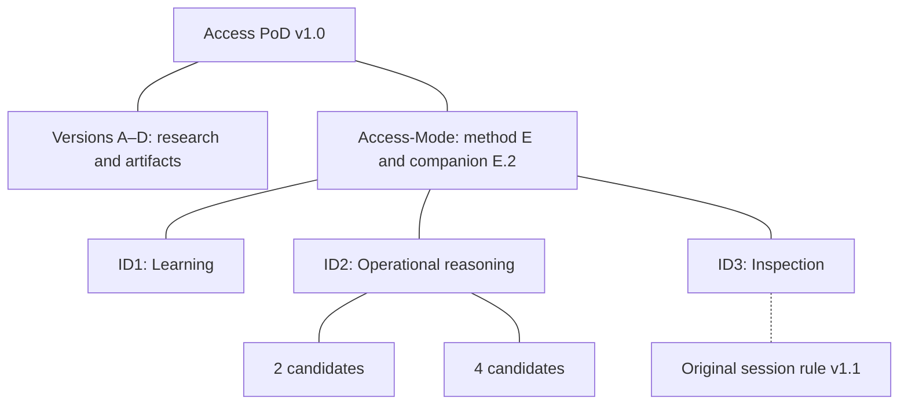

# Access PoD v1.0

**Governance research, supporting artifacts and Access-Mode**

**Consolidated edition v1.0** · **Public Review Draft** · **Developed by Alnotrea Labs**

**Preparation identity:** `v1.0-consolidated-draft`

Access PoD v1.0 brings the Access PoD governance papers, supporting artifacts and Access-Mode materials together in one organised collection. It provides a common starting point for exploring AI governance, studying evidence and review structures, and using structured AI-assisted reasoning in a scoped project.

The collection includes research papers, Markdown modules, worked examples, JSON schemas and records, optional local scripts, and preserved source releases. Researchers, educators, developers and governance practitioners can begin with the material relevant to their work.

This consolidated edition adds shared navigation, current reading guidance and documented additions, including an **ID2 four-candidate example alongside the original two-candidate example**. Each component retains its original publication identity and version.

[Start here](#start-here) · [Collection map](#collection-map) · [Research papers](#research-papers-and-artifacts) · [ID2 examples](#id2-examples-2-and-4-candidates) · [Getting started](#getting-started) · [Licence](#licence)

## Start here

| Your goal | Suggested starting point |
|---|---|
| Understand the governance foundations | [Version A paper](v1a/APOD-TR-002_A-WEB-of-Sharing-Trust-Responsibility_Vol2_Version-A_Public-Review.pdf), with the [current Version A notes](v1a/ERRATA.md) |
| Understand the Access-Mode method | [Paper orientation](v1.0-access-mode/releases/README_doc_orientation.md) and [Access-Mode collection guide](v1.0-access-mode/COLLECTION_GUIDE.md) |
| Begin a learning project | [ID1 learning release](v1.0-access-mode/ID_1-core/release_notes_ID_1.md), with the [current setup notes](v1.0-access-mode/ID_1-core/ERRATA.md) |
| Explore operational reasoning and comparisons | [ID2 example index](v1.0-access-mode/ID_2-Access/README.md), covering both **2 and 4 candidates** |
| Study inspection and record packaging | [ID3 introduction](v1.0-access-mode/ID_3-operator/README_ID_3.md), with the [current workflow guidance](v1.0-access-mode/ID_3-operator/MIGRATION_NOTES.md) |

You can read the papers and examples directly on GitHub or work from a downloaded copy. For an AI-assisted project, follow the [setup guidance below](#getting-started).

## Collection map

The map groups the included materials and their supporting references. ID1, ID2 and ID3 are distinct reasoning postures; select the one that fits your task.

Within ID2, **2 candidates** means a baseline and one variant; **4 candidates** means a baseline and three variants. The supplied ID3 example retains its original two-candidate inspection context. The sections below provide the reading links and scope for each part.

## Research papers and artifacts

Versions A–D provide the governance research and supporting artifact packs. Version E defines the Access-Mode method, while E.2 is an informative companion about artifact states and lifecycle.

| Material | Focus | Read and explore |
|---|---|---|
| **Version A · APOD-TR-002** | Governance foundations, authority and assurance semantics; CSC definitions, schemas and illustrative records | [Paper](v1a/APOD-TR-002_A-WEB-of-Sharing-Trust-Responsibility_Vol2_Version-A_Public-Review.pdf) · [Artifacts](v1a/) · [Current notes](v1a/ERRATA.md) |
| **Version B · APOD-TR-003** | Illustrative architecture, evidence preparation and review materials | [Paper](v1b/papers/APOD-TR-003_Vol2_Version-B.pdf) · [Artifacts](v1b/) · [Current notes](v1b/ERRATA.md) |
| **Version C · APOD-TR-004** | Onboarding, containment and informative policy/dataset lineage | [Paper](v1c/APOD-TR-004_Vol2_Version-C.pdf) · [Artifacts](v1c/) · [Current notes](v1c/ERRATA.md) |
| **Version D · APOD-TR-005** | Governance stress-testing, ethical evaluation, scenarios and rules of engagement | [Paper](v1d/paper/pdf/APOD-TR-005_Vol2_Version-D.pdf) · [Artifacts](v1d/) · [Current notes](v1d/ERRATA.md) |
| **Version E · APOD-TR-006** | Access-Mode and the separation of reasoning postures | [Method paper](<v1.0-access-mode/releases/APOD-TR-006 - Volume 2, Version E.pdf>) · [Collection guide](v1.0-access-mode/COLLECTION_GUIDE.md) |
| **Version E.2 · Companion** | Artifact states, lifecycle interpretation and Working-PoDs | [Companion paper](v1.0-access-mode/releases/APOD-TR-006-E.2.pdf) · [Reading orientation](v1.0-access-mode/releases/README_doc_orientation.md) |

The [Access-Mode Project Guide](v1.0-access-mode/orchestration/Access_Mode_Project_Guide.pdf) provides practical setup instructions. Read it alongside the [current collection guidance](v1.0-access-mode/COLLECTION_GUIDE.md), which explains the early mode examples and the later standalone releases.

## Choose an Access-Mode posture

| Mode | Purpose | How to interpret the work |
|---|---|---|
| **ID1 · Learning** | Explore concepts, responsibility, intent, scope and assumptions | Learning material remains non-operational and does not establish inspection findings. |
| **ID2 · Operational / Runtime Reasoning** | Explore scenarios, interpret signals and record baseline–variant comparisons | Outputs support human interpretation and decision-making within the stated example scope. |
| **ID3 · Inspection and Freeze Discipline** | Inspect selected records and study the documented packaging workflow | Structural checks and file integrity have a defined scope; they do not establish governance adequacy. |

The postures can be used for different tasks and are not a mandatory sequence or maturity scale. Each has its own project files, controls and interpretation boundaries.

## ID2 examples: 2 and 4 candidates

ID2 includes two separately documented comparison examples. Here, a **candidate** is a recorded case in the comparison.

| Example | Candidate arrangement | Supplied records and reading route |
|---|---|---|
| **2 candidates** | One baseline and one **time-pressure** variant | A session record and six module JSON records per case. Start with the [two-candidate guide](<v1.0-access-mode/ID_2-Access/docs/create_sessions/revisions/ID_2 Toolkit Script Examples Companion - current two-candidate guide.pdf>) and [ID2 index](v1.0-access-mode/ID_2-Access/README.md). |
| **4 candidates** | One baseline and three variants: **time pressure**, **ambiguity** and **lifecycle boundary** | A session record and a **Module 03** record per case. Start with the [four-candidate guide, full records and replay notes](v1.0-access-mode/ID_2-Access/four-candidates/README.md). |

The four-candidate example extends the recorded Module 03 comparison. The supplied ID3 inbox and workflow continue to demonstrate the original two-candidate case. For the shared rule's role and scope, see the [session-completeness rule notes](v1.0-access-mode/APOD-ID3-RULE-001-v1.1/MIGRATION_NOTES.md).

## Getting started

### Read and explore

Choose a paper or example from the tables above. The Markdown, PDFs and recorded examples can be studied without running scripts. Current component notes explain historical paths, wording and known limitations.

### Set up an AI-assisted project

1. Choose the Access-Mode posture that matches your task. **ID1 is a suitable starting point for learning the concepts.**
2. Read the [Project Guide](v1.0-access-mode/orchestration/Access_Mode_Project_Guide.pdf) and the selected component's current guidance.
3. Add that mode's **README, control file and all six priming modules** to a separate working project. Use the [collection guide](v1.0-access-mode/COLLECTION_GUIDE.md) to locate the correct standalone set.
4. Keep worked exemplars in a separate reference project. Record your own scope, inputs, assumptions and decisions in your working material.

The original shared modules and the early `modes/` examples have their own roles. Follow the collection guide when selecting project files so that the chosen README, control and module set belong together.

### Use the optional local tools

The ID2 and ID3 examples include PowerShell 7 tooling for their documented record and packaging workflows. Version D includes an optional Python schema-validation helper. These tools provide another way to examine the examples alongside manual reading and AI-assisted work.

Read the [ID2 guidance](v1.0-access-mode/ID_2-Access/MIGRATION_NOTES.md) or [ID3 guidance](v1.0-access-mode/ID_3-operator/MIGRATION_NOTES.md) before running a workflow. Use a separate working copy, adapt source and output paths to your environment, and review the resulting records.

## Sources and the consolidated edition

Collection v1.0 brings the selected releases together while preserving their original version identifiers. The [collection release notes](RELEASE_NOTES_v1.0_CONSOLIDATED.md) describe the common navigation, current guides and documented additions, including the separately supplied Version B paper and the four-candidate ID2 example.

- [Source and provenance records](provenance/) identify the original archives, imports and recorded corrections.
- [Collection manifest](collection-manifest.json) inventories this edition's files, excluding the manifest itself.
- Component errata and migration notes provide current reading guidance alongside preserved historical material.

Dated records describe checks performed in their stated context. The research materials support learning, standards exploration and technical review; they do not themselves confer certification, legal compliance or deployment approval.

## Licence

The publisher-owned material in this consolidated draft is distributed under the **[MIT License](LICENSE)**. Read the [licensing scope and source notices](LICENSING.md) for the included material, documented additions and preserved notices.

The selected distribution covers the Version A–D artifact packs, Access-Mode, the standalone ID1–ID3 materials and the original session-completeness rule. Other linked research and releases retain their own scope and terms.

Related research includes [Access-PoD Dataset Lifecycle v1.0](https://github.com/Access-PoD/access-pod-artifacts-core/releases/tag/v1.0-apod-dataset-lifecycle), [Q-Pathformer Enterprise v1.0](https://github.com/qpathformer/qpathformer-enterprise-v1.0-release/releases/tag/v1.0-qpathformer-enterprise) and [Q-Pathformer Enterprise v2.0 Standards Edition](https://github.com/qpathformer/qpathformer-enterprise-v2.0-standards-release/releases/tag/v2.0-qpathformer-enterprise-standards). These releases, along with workshop and workspace bundles, remain outside this selected distribution. See the [related-release context and terms](RELEASE_NOTES_v1.0_CONSOLIDATED.md#related-releases-and-terms) before reuse.

## Feedback and attribution

Developed by **Alnotrea Labs**, through the **Policy of Developments / Access PoD initiative**, led by **Anthony Siljeg**.

Feedback is welcome on clarity, navigation, example interpretation and reproducibility. When reporting an issue or proposing a change, identify the component, file, version and the behaviour or wording being discussed. For research references, cite the relevant paper's author, document ID and version, and identify the collection edition used.

[Access PoD organisation](https://github.com/Access-PoD) · [Original source releases](https://github.com/Access-PoD/access-pod-artifacts-core/releases)
